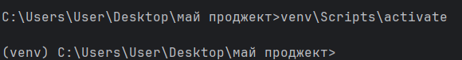
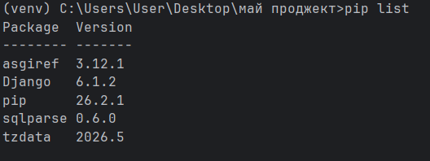
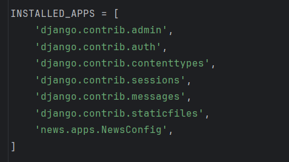
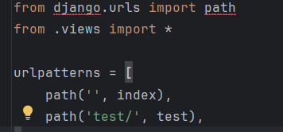
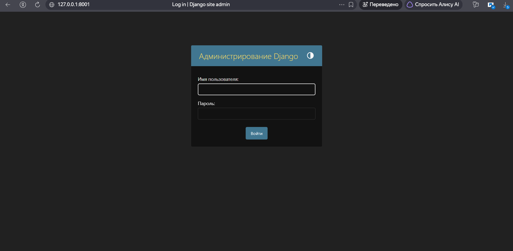
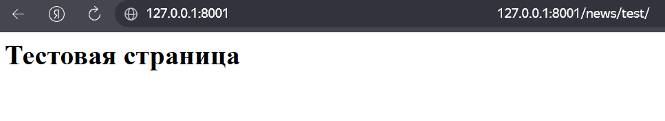
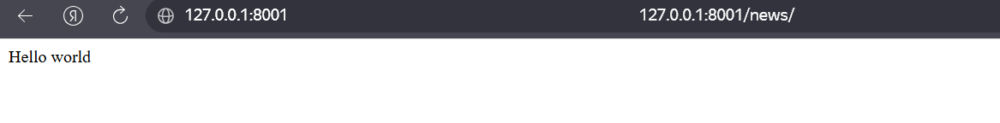

# Отчет по лабораторной работе № 1

**Дисциплина:** Разработка web-приложений

**Выполнил:** студент группы ПИЖ-б-о-25-1 (1), направление подготовки: 09.03.04 «Программная инженерия» Утов Алим Альбердович

**Проверила:** ассистент кафедры программной инженерии института информационных технологий и кибербезопасности Белик Ангелина Игоревна

**Тема:** Создание виртуального окружения. Контроллеры и маршруты

*Ставрополь, 2026*

---

## 📋 Содержание

1. [Цель работы](#1-цель-работы)
2. [Ход выполнения работы](#2-ход-выполнения-работы)
3. [Код программы](#3-код-программы)
4. [Результаты работы программы](#4-результаты-работы-программы)
5. [Выводы](#5-выводы)

---

## 1. Цель работы:

Настроить виртуальное пространство. Разработать контроллер приложения и организовать маршруты.

---

## 2. Ход выполнения работы:

1. **Создание виртуального окружения.** 
   Для изоляции зависимостей проекта было решено использовать первый способ — ручное создание виртуального окружения через терминал. В среде разработки PyCharm в папке проекта была выполнена команда `python -m venv venv`. После успешного создания папки `venv`, окружение было активировано командой `venv\Scripts\activate`. Признаком успешной активации является появление префикса `(venv)` в начале строки терминала.
   

2. **Установка фреймворка Django.** 
   Для установки фреймворка в активированное виртуальное окружение была введена команда `pip install Django`. После завершения установки была проведена проверка списка пакетов с помощью команды `pip list`. В списке успешно отобразился установленный пакет Django.

3. **Создание проекта Django.** 
   Создание проекта выполнялось с помощью утилиты `django-admin`. В терминале была введена команда (с точкой в конце, чтобы файл `manage.py` создался в корне текущей папки): `django-admin startproject MySite .` 
   В результате в дереве проекта появилась папка конфигурации `MySite` и файл управления `manage.py`. Для проверки работоспособности был запущен отладочный сервер. Так как стандартный порт 8000 был занят, запуск был произведен на порту 8001: `python manage.py runserver 8001`. При переходе по адресу `http://127.0.0.1:8001/` в браузере отобразилась приветственная страница Django с ракетой, свидетельствующая об успешной установке.

4. **Создание приложения и его регистрация.** 
   Для создания функционала сайта было создано новое приложение `news` с помощью команды `python manage.py startapp news`. Чтобы Django корректно воспринимал новое приложение, оно было зарегистрировано в файле конфигурации `MySite/settings.py`. В список `INSTALLED_APPS` была добавлена строка `'news.apps.NewsConfig'`.

5. **Создание контроллеров (views).** 
   Контроллеры (представления) описываются в файле `news/views.py`. В него был добавлен импорт `HttpResponse` и созданы две функции-контроллера:
   - `index` — возвращает простой текстовый ответ `'Hello world'`.
   - `test` — возвращает HTML-строку с заголовком `<h1>Тестовая страница</h1>`.

6. **Настройка маршрутизации.** 
   Сначала в главном файле `MySite/urls.py` был подключен модуль маршрутов нашего приложения с помощью функции `include`. Затем в папке приложения `news` был создан собственный файл `urls.py`, где были прописаны пути к созданным контроллерам.

7. **Проверка работы приложения.** 
   После настройки маршрутов сервер был перезапущен. В браузере были проверены все маршруты:
   - По адресу `http://127.0.0.1:8001/news/` отобразилась страница с текстом `Hello world`.
   - По адресу `http://127.0.0.1:8001/news/test/` отобразилась страница с заголовком «Тестовая страница».
   - По адресу `http://127.0.0.1:8001/admin/` открылась стандартная страница авторизации Django.
   В терминале PyCharm при этом были видны успешные HTTP GET-запросы к этим страницам (статус 200).



---

## 3. Код программы:

### Файл news/views.py (Контроллеры)

```python
from django.shortcuts import render
from django.http import HttpResponse

def index(request):
    return HttpResponse('Hello world')

def test(request):
    return HttpResponse('<h1>Тестовая страница</h1>')
Файл MySite/urls.py (Главный маршрутизатор)
python
from django.contrib import admin
from django.urls import path, include

urlpatterns = [
    path('admin/', admin.site.urls),
    path('news/', include('news.urls')),
]
Файл news/urls.py (Маршрутизатор приложения)
python
from django.urls import path
from .views import *

urlpatterns = [
    path('', index),
    path('test/', test),
]
```

## Вывод

В ходе лабораторной работы было настроено виртуальное окружение (вторым способом – автоматически средствами PyCharm), установлен Django и создан проект `MySite` с приложением `news`. Разработаны контроллеры `index` и `test` в файле `views.py`, возвращающие HTTP-ответы. Организованы маршруты: сначала в главном `urls.py`, затем с помощью функции `include` маршруты вынесены в `news/urls.py`, что сделало страницу `test` вложенной в приложение `news`. Работа сервера проверена: страницы `/news/` и `/news/test/` отображаются корректно, в терминале видны все запросы. Таким образом, виртуальное окружение настроено, контроллеры созданы, маршруты организованы.